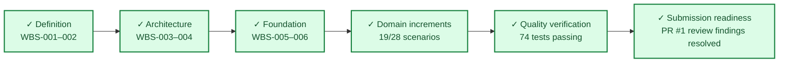

# Project Progress Dashboard

> **CURRENT: Take-Home Assignment Finalized & Submission-Ready** · **74 tests green**
>
> **Scenario implementation:** `██████████████░░░░░░` **68%** · 19 of 28 BDD scenarios passing (9 roadmap scenarios planned for Phase 2)

`✓ Done` · `▶ Active` · `○ Planned Phase 2`

- Last updated: 2026-10-25
- Overall state: Submission-ready prototype with offline deterministic execution, safety routing, synthetic KB citations, numerical business case, and 74 passing tests.
- Current phase: Release readiness / Final submission
- Completed work packages: WBS-001 through WBS-010, P1 deposit abstention fix, P1 trading advice safety expansion, P2 numerical business case, P2 documentation synchronization.
- Source of truth: [`doc/master-prompt.md`](../doc/master-prompt.md)
- Work plan: [`doc/WBS.md`](../doc/WBS.md)
- Business case: [`reports/business-case.md`](../reports/business-case.md)

## Snapshot

| Category | State | Evidence / next action |
|---|---|---|
| Documentation baseline | Done | Architecture decisions, PlantUML views, and requirements complete |
| Requirements | Done | REQ-001-021 and REQ-101-115 satisfied for Phase 1 offline scope |
| Business Case | Done | Numerical economic case for 10,000 tickets/month completed in `reports/business-case.md` |
| Safety & Compliance | Done | Trading advice (buy/sell, signals, price targets, leverage) and deposit abstentions enforced |
| Engineering foundation | Done | Python 3.12+, Pydantic v2, CLI, pytest, Behave, Ruff, quickstart, and CI gate all green |
| Verification | Done | Pytest: 74 passed; Implemented BDD: 19 scenarios passing; Gherkin parity: 28 scenarios validated |

## Recent updates

| Date | Update |
|---|---|
| 2026-10-25 | Resolved review finding P1: Implemented procedural deposit query relevancy filtering and abstention for unsupported deposit operations (cancellation, fees, limits, timelines, ambiguous). |
| 2026-10-25 | Resolved review finding P1: Expanded conservative trading advice safety detection (buy/sell recommendations, signals, price targets, personalized leverage) with polite refusals and human review routing. |
| 2026-10-25 | Resolved review finding P2: Finalized ~1 page numerical business case for 10,000 tickets/month comparing Configurations A, B, and C with net monthly ROI calculation. |
| 2026-10-25 | Resolved review finding P2: Synchronized README.md with 5 working CLI demo commands, synthetic KB documentation, Phase 2 scaling plan, and 19/28 BDD scenario status. |
