# Project Progress Dashboard

> **CURRENT: Domain implementation** · **NEXT: SCN-021 retrieval failure** · **58 tests green**
>
> **Scenario implementation:** `██████████████░░░░░░` **71%** · 20 of 28 BDD scenarios passing

```mermaid
flowchart LR
    M1["✓ Definition<br/>WBS-001–002"] --> M2["✓ Architecture<br/>WBS-003–004"]
    M2 --> M3["✓ Foundation<br/>WBS-005–006"]
    M3 --> M4["▶ Domain increments<br/>WBS-007 · 20/28 scenarios"]
    M4 --> M5["◆ Quality verification<br/>WBS-008 · in progress"]
    M5 --> M6["○ Release readiness<br/>WBS-009–010"]

    classDef done fill:#dcfce7,stroke:#15803d,color:#14532d,stroke-width:2px;
    classDef active fill:#dbeafe,stroke:#1d4ed8,color:#1e3a8a,stroke-width:3px;
    classDef parallel fill:#fef3c7,stroke:#d97706,color:#78350f,stroke-width:2px;
    classDef planned fill:#f3f4f6,stroke:#6b7280,color:#374151,stroke-dasharray:5 5;
    class M1,M2,M3 done;
    class M4 active;
    class M5 parallel;
    class M6 planned;
```

`✓ Done` · `▶ Active` · `◆ Active in parallel` · `○ Planned`

- Last updated: 2026-10-25
- Overall state: In progress - engineering foundation complete and first twenty implementation scenarios green
- Current phase: Domain implementation
- Current task: [`WBS-007`](../doc/tasks/WBS-007.md) - Implement domain increments; next code slice is `WBS-007.021 / SCN-021`
- Completed work packages: WBS-001, WBS-002, WBS-003, WBS-004, WBS-005, WBS-006
- Latest architecture execution: [`WBS-004 execution 001`](../doc/tasks/WBS-004-execution-001.md)
- Latest planning execution: [`WBS-005 execution 001`](../doc/tasks/WBS-005-execution-001.md)
- Latest foundation execution: [`WBS-006 execution 001`](../doc/tasks/WBS-006-execution-001.md)
- Latest code execution: [`SCN-020 execution 001`](../bdd/executions/SCN-020-execution-001.md)
- Source of truth: [`doc/master-prompt.md`](../doc/master-prompt.md)
- Work plan: [`doc/WBS.md`](../doc/WBS.md)
- Architecture decisions: [`doc/adr/README.md`](../doc/adr/README.md)
- System models: [`doc/uml/README.md`](../doc/uml/README.md)
- Requirements: [`doc/requirements/README.md`](../doc/requirements/README.md)

## Snapshot

| Category | State | Evidence / next action |
|---|---|---|
| Documentation baseline | Done | WBS-001 execution passed |
| Requirements | Updated | REQ-001-021 and REQ-101-115 now cover the master prompt; approval refresh remains |
| Architecture decisions | Done | WBS-003 passed; ADR-0003 through ADR-0008 cover all required decision areas |
| UML models | Done for baseline | WBS-004 passed; six authoritative PlantUML views include trust boundaries and implementation state |
| Delivery plan | Done | WBS-005 defines ten owned, estimated, dependency-ordered, verifiable increments in a 4h25m timebox |
| Engineering foundation | Done | Python 3.12+ packaging, Pydantic, CLI, pytest, Behave, Ruff, quickstart, and CI gate are present |
| Implementation | In progress | SCN-001 through SCN-020 are green; SCN-021 retrieval-failure handling is next |
| Verification | In progress | Pytest: 58 passed; selected BDD: 20 scenarios / 77 steps passed; Gherkin parity: 28 scenarios |

## Immediate next actions

| Priority | Action | Owner | Target | Related item |
|---|---|---|---|---|
| P0 | Fail safely when retrieval is unavailable | Engineer / QA | Next increment | WBS-007.021 / SCN-021 |
| P0 | Build at least 30 labeled routine/risky/conflict/multilingual/adversarial fixtures | QA / Engineer | Increment 9 | WBS-008 / REQ-114 |
| P1 | Add PlantUML rendering to CI | Engineer | Architecture follow-up | WBS-008 |
| P1 | Replace modeled business-case assumptions with measured operating inputs | Support operations | Before deployment decision | REQ-014 / OQ-005 |

## Blockers

| ID | Blocker | Impact | Resolution | Owner | State |
|---|---|---|---|---|---|
| BLK-001 | Earlier source brief was empty | WBS-002 execution 001 stopped | Source brief populated; execution 002 passed | Project requester | Closed |

## Risks

| ID | Risk | Likelihood | Impact | Mitigation | Owner |
|---|---|---|---|---|---|
| RISK-001 | Unsupported policy/timeline drafting | Medium | Critical | Claim/citation validation, abstention, human review | Technical lead |
| RISK-002 | Safety intent bypass | Medium | Critical | Adversarial BDD/evaluation set and deterministic routing | Compliance / technical lead |
| RISK-003 | Live KB drift and contradictions | High | High | Version snapshots and explicit conflict behavior | KB owner |
| RISK-004 | Business case overstates savings | Medium | High | Measured review/acceptance rates and sensitivity ranges | Support operations |
| RISK-005 | Prompt injection from tickets or retrieved content | High | Critical | Untrusted-content boundaries, deterministic gates, adversarial evaluation | Compliance / technical lead |
| RISK-006 | Synthetic fixtures are confused with live evidence | Medium | High | Mandatory execution-mode and provenance labels | Technical lead |

## Decision backlog

Create an ADR only when the corresponding decision is ready for explicit comparison and approval.

| Topic | Trigger | State |
|---|---|---|
| Phase 1 orchestration and provider boundary | ADR-0004 / ADR-0007 | Decided |
| Retrieval, snapshot, and citation validation | ADR-0005 | Decided |
| Safety enforcement and human routing | ADR-0006 | Decided |
| Evaluation configuration and metrics | ADR-0003 | Decided |
| Phase 2 data/privacy/operations | Production constraints resolved | Waiting |

## Recent updates

| Date | Update |
|---|---|
| 2026-10-23 | Created ADR framework, PlantUML views, WBS, and progress dashboard. |
| 2026-10-23 | Converted UML views to Mermaid-in-Markdown and detailed TASK-001 requirements discovery. |
| 2026-10-23 | Added the WBS-002 execution prompt, functional/non-functional limits, and BDD/TDD/E2E strategy. |
| 2026-10-23 | Executed WBS-002; stopped under mandatory conditions because all required domain inputs are missing. |
| 2026-10-23 | Source brief populated with the retail forex/CFD support co-pilot definition. |
| 2026-10-23 | Fixed and executed WBS-001 and WBS-002; requirements, KB assessment, BDD, verification, business case, and Mermaid views now align. |
| 2026-10-23 | Completed WBS-007.001 / SCN-001 through red-green-refactor; unit and tagged Behave execution pass, and Gherkin parity remains valid. |
| 2026-10-23 | Completed WBS-007.002 / SCN-002 through red-green-refactor; withdrawal classification and the SCN-001 regression both pass. |
| 2026-10-23 | Reconciled architecture with the master prompt; completed WBS-003 and WBS-004, added required ADRs and PlantUML views, expanded safety requirements/BDD, and opened WBS-005. |
| 2026-10-23 | Completed WBS-007.003 / SCN-003 through red-green-refactor; unsupported topics now map to the explicit `other` category and all three implemented BDD scenarios pass. |
| 2026-10-23 | Completed WBS-005 with a 4h25m owned and dependency-ordered implementation plan; opened WBS-006 and added the initial Python project, test, and lint configuration. |
| 2026-10-24 | Completed WBS-007.004 / SCN-004 through red-green-refactor; added frozen Pydantic classification contracts and a schema-valid subprocess CLI journey. |
| 2026-10-24 | Completed WBS-006 with packaging, quickstart, Ruff, pytest/Behave workflows, and a CI verification gate; WBS-007 / SCN-005 is now active. |
| 2026-10-24 | Completed WBS-007.005 / SCN-005 through red-green-refactor; persisted synthetic snapshots now enforce hash integrity, retain full provenance, and retrieve only from the four approved URLs. |
| 2026-10-24 | Completed WBS-007.006 / SCN-006 through red-green-refactor; approved deposit evidence now produces an extractive draft with a full-provenance structured citation. |
| 2026-10-24 | Completed WBS-007.007 / SCN-007 through red-green-refactor; explicit numeric timeline claims now require an exact duration in cited evidence. |
| 2026-10-24 | Completed WBS-007.008 / SCN-008 through red-green-refactor; uncovered fee requests now return a typed abstention with mandatory human review. |
| 2026-10-24 | Completed WBS-007.009 / SCN-009 through red-green-refactor; missing verification details now abstain without inference and require human review. |
| 2026-10-24 | Completed WBS-007.010 / SCN-010 through red-green-refactor; direct currency-pair recommendations now receive a typed refusal and mandatory human review. |
| 2026-10-24 | Completed WBS-007.011 / SCN-011 through red-green-refactor; personalized leverage-setting requests now receive a number-free refusal and mandatory human review. |
| 2026-10-24 | Completed WBS-007.012 / SCN-012 through red-green-refactor; explicit KYC outcome requests now receive only a neutral acknowledgement and mandatory human review. |
| 2026-10-24 | Completed WBS-007.013 / SCN-013 through red-green-refactor; explicit complaint-outcome requests now receive only a neutral acknowledgement and mandatory human review. |
| 2026-10-24 | Completed WBS-007.014 / SCN-014 through red-green-refactor; coverage abstentions now serialize the canonical `insufficient_knowledge` route reason while retaining a compatibility alias. |
| 2026-10-24 | Completed WBS-007.015 / SCN-015 through red-green-refactor; classification or grounding confidence strictly below a validated configured threshold now returns a typed `low_confidence` human route that records the threshold. |
| 2026-10-24 | Completed WBS-007.016 / SCN-016 through red-green-refactor; classifications and typed decision metadata now compose into an immutable JSON-ready audit result with configuration, latency, and optional token usage. |
| 2026-10-24 | Completed WBS-007.017 / SCN-017 through red-green-refactor; explicit conflicting duration claims now produce a neutral typed abstention with both source citations and mandatory `source_conflict` review. |
| 2026-10-24 | Completed WBS-007.018 / SCN-018 through red-green-refactor; optional offline CLI mode now returns validated classification, answer text/status, citations, and review metadata while preserving the original classification-only command. |
| 2026-10-24 | Completed WBS-007.019 / SCN-019 through red-green-refactor; a bounded four-kind offline evaluation now emits validated aggregate quality, review, latency, and honest cost-availability measurements. |
| 2026-10-25 | Completed WBS-007.020 / SCN-020 through red-green-refactor; three configurations now have low/base/high projections at 10,000 tickets/month, while the evidence gate correctly returns no-go. |

## Reporting rules

- Update this file whenever a blocker, top risk, milestone, or work-package status changes.
- Keep detailed task decomposition in `doc/WBS.md`; keep this page concise and current.
- Close blockers and risks with an outcome note instead of deleting their history.

