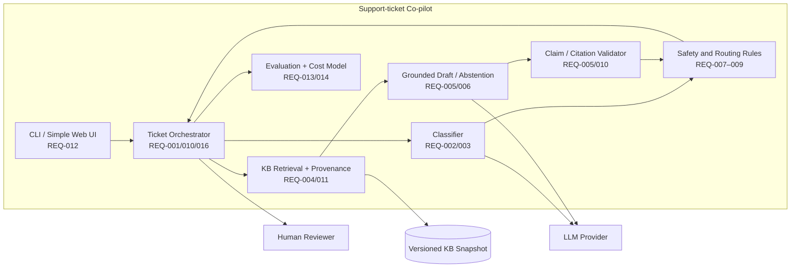

# Component Overview

This logical view shows requirement-driven responsibilities. Technology and provider choices remain WBS-003 decisions.

Safety and deterministic validation remain separate from provider inference so hard rules are not prompt-only controls.

