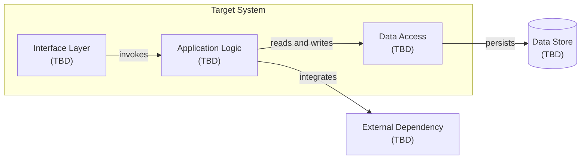

# Component Overview

This logical view shows candidate responsibilities, not an approved architecture. Component boundaries must follow accepted requirements and ADRs.

Refinement trigger: TASK-001 defines responsibilities, data ownership, and interfaces, followed by architecture decisions in `WBS-003`.

