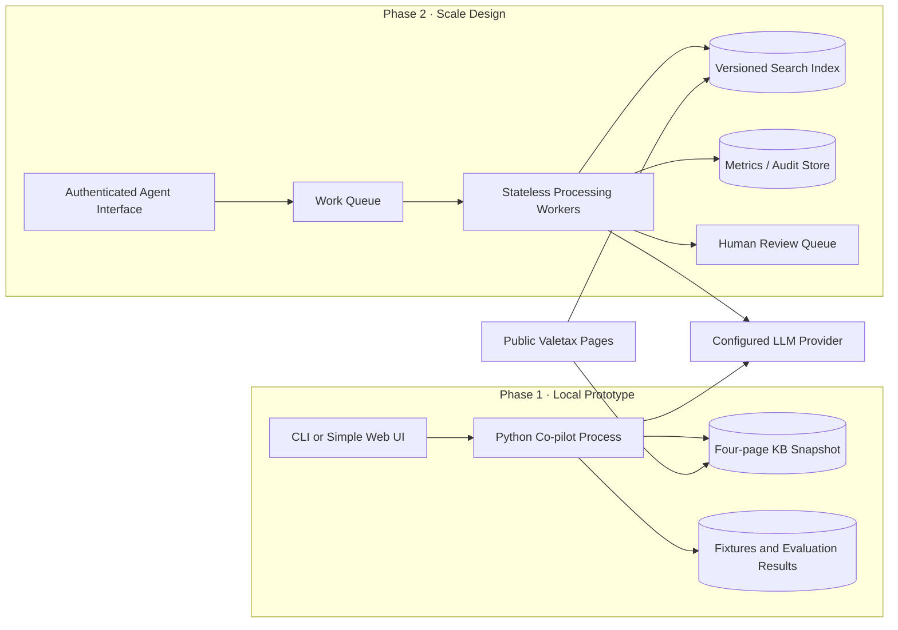

# Deployment View

This view separates the timeboxed local prototype from the Phase 2 production shape. It does not select a cloud or LLM vendor.

Production data controls, SLA, peak factor, retention, and provider terms remain explicit pre-production decisions.

