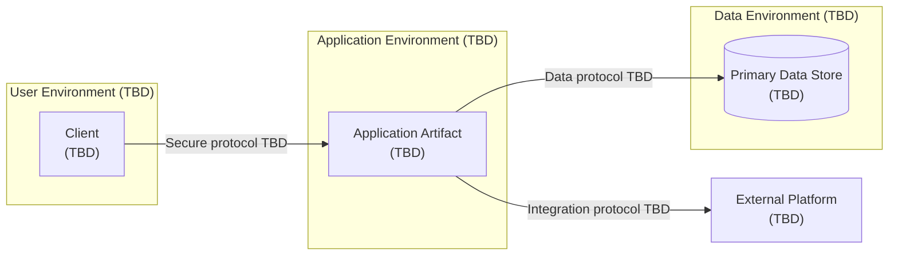

# Deployment View

This view captures the categories of runtime nodes that may be needed. It does not select a hosting platform or protocol.

Refinement trigger: TASK-001 defines availability, scale, security, data, environment, observability, backup, and recovery constraints.

