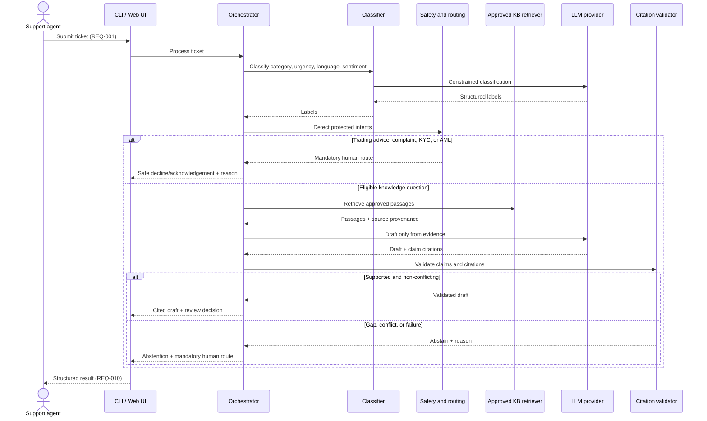

# Primary Use-Case Sequence

This sequence covers the primary agent-assist path, including abstention and mandatory human review.

The human reviewer remains accountable for routed outcomes and customer-facing use.

