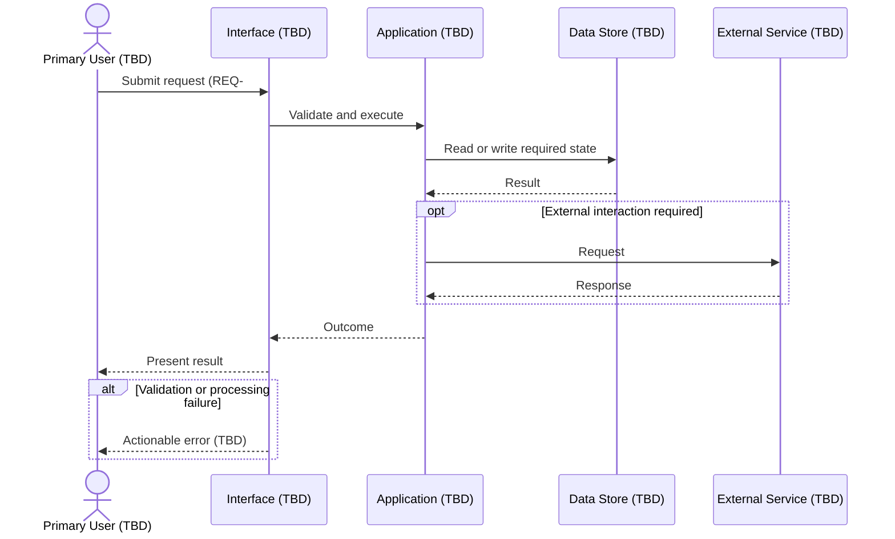

# Primary Use-Case Sequence

This sequence is a structural placeholder for the main end-to-end use case. Concrete messages and failure behavior require approved requirements.

Refinement trigger: TASK-001 identifies the first usable journey, alternate paths, failure states, and acceptance evidence.

