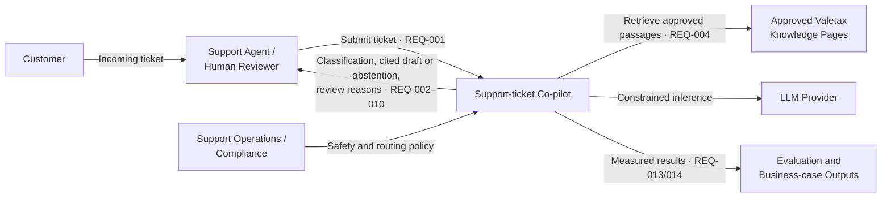

# System Context

This view identifies the Phase 1 co-pilot boundary and its external actors and data sources.

The co-pilot assists agents; it does not execute transactions, decide complaints/KYC/AML outcomes, or provide trading advice.

