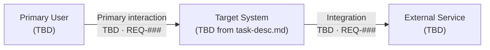

# System Context

This view identifies external actors, the target-system boundary, and external dependencies. Names remain placeholders until TASK-001 is approved.

Boundary rule: replace placeholders only with approved actors, responsibilities, and dependencies from TASK-001.

